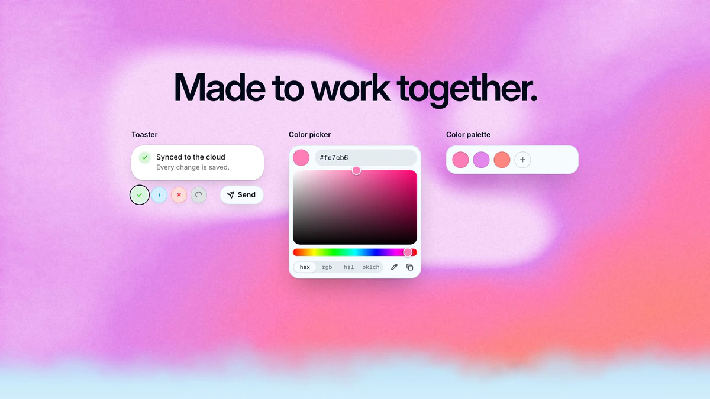

<div align="center">
  <br />
  <a href="https://cloudlet.dev"></a>
  <h1>Cloudlet</h1>
  <h3>Made to work together.</h3>
  <p>A Toaster, a color picker and a palette for React.<br />Change one color and the whole kit answers.</p>
  <p>
    <a href="https://github.com/Meerzus/cloudlet/stargazers"></a>
    <a href="https://github.com/Meerzus/cloudlet/blob/main/LICENSE"></a>
  </p>
  <p>
    <a href="https://cloudlet.dev/docs"><strong>Documentation</strong></a> ·
    <a href="https://cloudlet.dev/docs/installation"><strong>Installation</strong></a> ·
    <a href="https://cloudlet.dev"><strong>Components</strong></a>
  </p>
  <br />
</div>

<a href="https://cloudlet.dev">
  
</a>

## What's inside

Every component is a shadcn registry item: the CLI copies its source into your project, and every
line is yours.

| Component | What it does | |
|---|---|---|
| [Toaster](https://cloudlet.dev/toaster) | Notifications that stack softly and open into a card when it matters. | [Docs](https://cloudlet.dev/docs/components/toaster) |
| [Color picker](https://cloudlet.dev/color-picker) | Hex, rgb, hsl and oklch, an eyedropper and full keyboard support. | [Docs](https://cloudlet.dev/docs/components/color-picker) |
| [Color palette](https://cloudlet.dev/color-picker#palette) | Up to four colors, built on the color picker. | [Docs](https://cloudlet.dev/docs/components/color-palette) |

## Installation

```sh
npx shadcn@latest add @cloudlet/toaster
npx shadcn@latest add @cloudlet/color-picker
npx shadcn@latest add @cloudlet/color-palette
```

The Toaster's registry item is a thin wrapper over its npm package, which also works on its own:

```sh
npm install @cloudlet/toast
```

If Cloudlet saves you some work, a star helps the next developer find it.

## Contributing

Bug reports and ideas are welcome in [issues](https://github.com/Meerzus/cloudlet/issues). The
workspace, the commands and the checks are in [CONTRIBUTING](CONTRIBUTING.md). Security problems go
through [SECURITY](SECURITY.md), not public issues. Everyone taking part follows the
[Code of Conduct](CODE_OF_CONDUCT.md).

## License

[MIT](LICENSE). Third-party notices: [packages/toast](packages/toast/THIRD_PARTY_NOTICES.md),
[apps/site](apps/site/THIRD_PARTY_NOTICES.md). The [changelog](CHANGELOG.md) lists every release.
